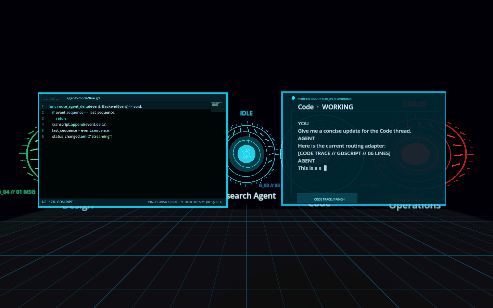
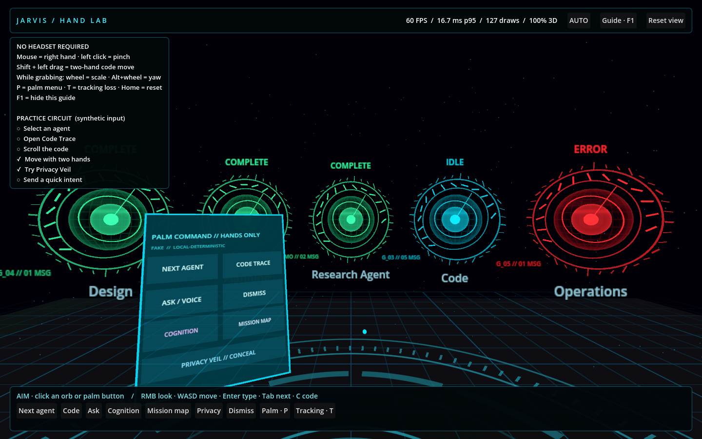
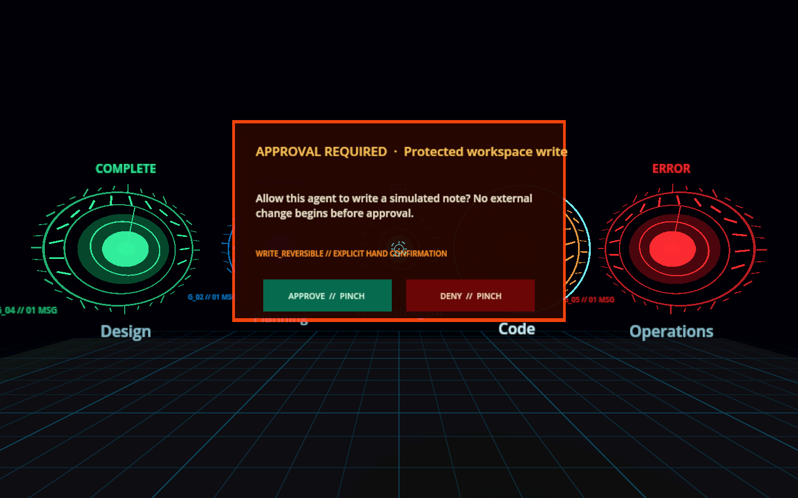
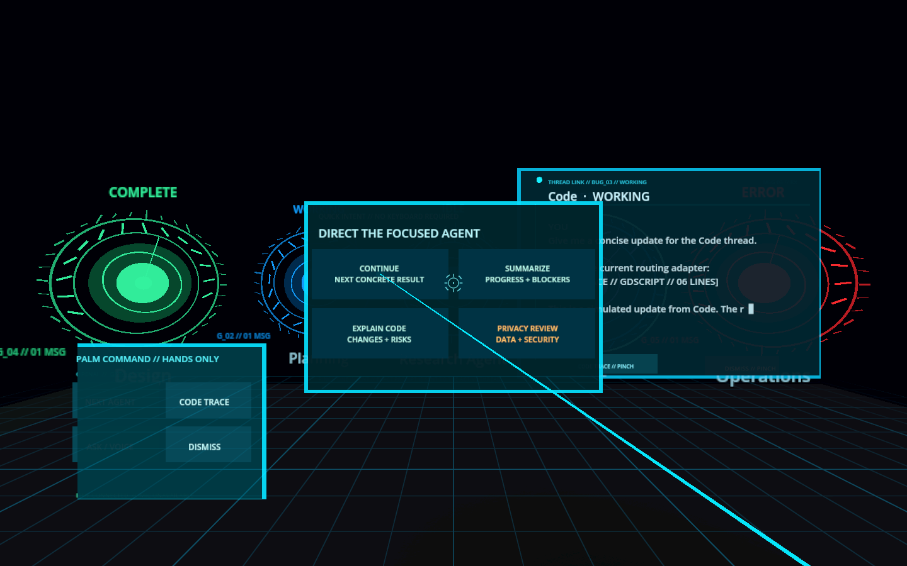

# Spatial Agent XR

A Quest-ready Godot 4.7 spatial agent workbench with a complete desktop simulator. Eight data-driven agent orbs run out of the box in offline mode; the same client can connect to the included local WebSocket backend for persistent threads, streaming responses, cancellation, safe telemetry, approval-gated tools, OpenAI, Claude, DeepSeek, or an explicit dual-provider Council mode.

> **Rev 2 (spatial dev cockpit):** the headset is now a terminal for a companion daemon that owns the workspace. Agents work in isolated `git worktree` branches, MCP servers (filesystem, git, shell, browser, GitHub) expose real tools behind the approval gate, LAN devices pair with a short code over TLS, and new cockpit panels cover workspace state, diff review, file browsing, and daemon settings. See [Spatial Dev Cockpit](docs/SPATIAL_DEV_COCKPIT.md) and the new ADRs in [Decisions](docs/DECISIONS.md).



## What is complete

- Desktop movement, center-ray hover/select, semantic focus/dismiss, and stable 8–12-orb layout.
- Original holographic instrument treatment with concentric orb telemetry, calibrated ticks, dark-glass panels, an animated reticle, and a procedural spatial grid.
- Readable world-space transcript panel with incremental assistant output.
- Vim-inspired floating code trace with streamed fenced-code extraction, line numbers, syntax highlighting, minimap, semantic scrolling, and a bounded animated 3D sculpture for fenced diffs.
- Keyboard composer and commands for create, focus, rename, archive, cancel, list, and the safe tool demonstration.
- Versioned provider-neutral WebSocket protocol, reconnection with snapshot restoration, packet limits, strict command validation, and per-session rate limiting.
- SQLite persistence and a provider abstraction with deterministic fake, OpenAI Responses, Claude, DeepSeek chat completions, and explicit OpenAI+Claude Council adapters.
- Explicit backend-authoritative approval UI with modal world-space Approve/Deny pinch targets and a content-blind **Ghost Future** showing route, scope, side effects, and reversibility before consent. The included `demo.write_note` tool is simulated and makes no external change.
- Privacy-oriented local push-to-talk boundary using `whisper.cpp`; microphone audio is not sent over WebSocket and temporary recordings are deleted by default.
- A real `XROrigin3D`/`XRCamera3D` runtime that activates only when OpenXR is initialized, with optical-hand-only joint polling, stabilized hand ray, thumb-index pinch hysteresis, pinch-drag code scrolling, and two-hand Code Trace transforms. Controller-inferred skeletons are rejected.
- A left-palm command console with live provider/model/link telemetry and pinch targets for focus, Code Trace, Cognition Lens, Mission Map, Privacy Veil, ask/voice, and dismiss. When speech is unavailable, ASK opens a four-choice hand-only quick-intent panel.
- A summonable Spatial Cognition Layer: live backend activity becomes an animated causal constellation around the focused agent, a hand-scrubbable temporal black box, and a privacy field that makes local versus hosted provider routing visible without rendering prompt contents.
- A room-scale Mission Map with animated, content-blind status pulses over explicit parent links and clearly labelled focused-agent correlations. It is capped at 12 links for standalone hardware.
- A fail-closed Privacy Veil that hides agent identities, transcripts, code, and telemetry and stops active microphone capture while honestly indicating that background runs continue.
- Procedurally synthesized 3D audio cues and a session-only semantic room-anchor registry. No audio assets, prompt text, raw room mesh, or scene image enters either telemetry boundary.
- A pinned Meta Quest 3/3S Android export profile, verified vendor-plugin installer, secure ADB backend tunnel, and one-command debug deploy helper.

See [completion status](docs/STATUS.md) for the few checks that require the user's own provider credential, microphone/model, or Quest hardware.

The current desktop update is **Hand Lab**, on the v0.4 Autonomous Supervision foundation. See the [Hand Lab guide](docs/HAND_LAB.md) and [verified status](docs/STATUS.md).

## Quick start: Hand Lab (no headset)

Double-click **Launch Hand Lab.command**. The new desktop Hand Lab gives you a free mouse pointer, click-to-pinch, a palm menu, a guided practice circuit, and Shift-drag two-hand code manipulation. It explicitly disables OpenXR for this launch. See [the Hand Lab guide](docs/HAND_LAB.md) for the full testing workflow and controls.

New graphics include Fresnel/plasma agent cores, a procedural reactor floor and up to 3,200 GPU-animated motes. Auto/Eco/Balanced/Ultra presets and a live frame-time display let you balance clarity and speed. The room decorations are omitted from real XR passthrough.



## Classic desktop controls

Requirements for the desktop simulator: Godot 4.7.2 (or a compatible 4.7.x build), keyboard, and mouse. No Python, account, API key, network, microphone, or headset is needed. These peripherals are not part of the final XR interaction target.

1. Open `client-godot/project.godot` in Godot.
2. Set `spatial_agent/desktop_hand_lab=false`, or launch with `-- --classic-desktop`. The committed configuration uses `backend_mode="fake"`.
3. Aim with the center reticle and left-click an orb.

Controls:

| Input | Action |
|---|---|
| Mouse | Look / aim |
| Left click | Select orb |
| W/A/S/D | Move horizontally |
| Space/Ctrl | Move vertically |
| Enter | Open or submit the message composer |
| Tab | Cycle focused thread |
| C | Open / close the focused thread's code trace |
| J / K | Scroll the open code trace |
| g / G | Go to top / bottom of the code trace |
| Escape/right click | Cancel typing or dismiss focus |
| Hold V | Local push-to-talk, when configured |
| Y / N | Approve / deny the visible tool request |
| F3 | Toggle diagnostics |
| 1 / 2 / 3 | Add thread / remove newest / cycle status in fake mode |

The headset workflow is hand-only: point with an index ray, pinch to select, pinch-drag to scroll, use the left-palm console for workspace actions, and pinch with both hands to reposition/scale Code Trace. **Cognition** summons causal telemetry, **Mission Map** reveals swarm activity, and **Privacy Veil** immediately conceals the workspace. No controller action map is required. If headset speech is unavailable, ASK / VOICE opens fixed, clearly labeled intents for Continue, Summarize, Explain Code, and Privacy Review. See the [hand-only XR target](docs/HAND_INTERACTION_TARGET.md).

Sensitive actions replace the workspace with a blocking spatial gate. Approve and Deny are separate, generous pinch targets; gaze or dwell alone can never confirm an action.



Composer commands:

```text
/help
/list
/new TITLE
/focus NAME
/rename NEW TITLE
/archive [NAME]
/cancel [NAME]
/tool status
/tool clock
/tool note NOTE
```

## Meta Quest 3/3S

The project includes an Android OpenXR export preset and `scripts/quest.sh`. After Godot's export templates, JDK 17, Android SDK, and Quest developer mode are ready:

```sh
./scripts/quest.sh setup
./scripts/quest.sh doctor
./scripts/quest.sh deploy
```

`deploy` exports an ARM64 debug APK, installs it over ADB, and maps the headset's `localhost:8787` back to the Mac backend. This keeps the backend on loopback instead of opening an unauthenticated LAN port. Open the app from Quest's Unknown Sources library. Full prerequisites and troubleshooting are in [Quest 3/3S setup](docs/QUEST_3S_SETUP.md).



## Run the persistent local backend

From `backend/`:

```sh
python3 -m venv .venv
.venv/bin/python -m pip install --upgrade pip
.venv/bin/python -m pip install -e .
.venv/bin/spatial-agent-backend
```

Then change the project settings in `client-godot/project.godot`:

```ini
[spatial_agent]
backend_mode="websocket"
backend_websocket_url="ws://127.0.0.1:8787/ws"
```

The backend binds to loopback and writes `backend/data/spatial_agent.db` by default. Copy `backend/.env.example` to `backend/.env` and select `fake`, `openai`, `claude`, `deepseek`, or `council`. Council requires both keys, sends eligible context to both providers, and can roughly double provider cost. Provider keys never enter Godot or the APK. See [backend setup](backend/README.md).

## Optional local voice

Voice is off by default so the application does not request microphone access unexpectedly. Install `whisper.cpp`, download a compatible local GGML model, and set an absolute model path:

```ini
[spatial_agent]
speech_enabled=true
whisper_cli_path="whisper-cli"
whisper_model_path="/absolute/path/to/ggml-base.en.bin"
speech_retain_recordings=false
speech_max_recording_seconds=20.0
```

Hold V while speaking and release it to transcribe. Recognition runs as a child process without blocking the Godot frame loop. The resulting text—not the audio—is routed through `voice.transcript.final` to the focused thread. This adapter is desktop-only; Quest falls back to the hand-only quick-intent panel until a mobile-native speech adapter is configured.

## Sensitive-data notes

- Fake mode is fully offline.
- Local-backend mode stores conversation text in an unencrypted local SQLite file.
- OpenAI, Claude, and DeepSeek modes send prompt text and conversation context to the selected provider; all are opt-in and require backend-only environment keys.
- Council mode sends the same eligible context to both OpenAI and Anthropic, displays the two perspectives separately, applies no hidden tie-break, and may roughly double token/API cost.
- Local voice temporarily writes a WAV under Godot's per-user data directory, then deletes it after transcription unless retention is explicitly enabled.
- Backend logs contain identifiers, event types, timing, and error classes—not prompt bodies or credentials.
- The included tool is allowlisted, approval-gated, and simulated. There is no arbitrary shell tool.
- Privacy Veil conceals local holograms and stops active capture; it does not cancel model runs, erase SQLite history, or prevent someone else from seeing the physical display.

Read [Security and privacy](docs/SECURITY_AND_PRIVACY.md) before using real sensitive content.

## Test

After creating `backend/.venv`, run:

```sh
./scripts/test_all.sh
```

The suite covers backend unit/integration behavior, all Godot milestones, offline event reduction, commands and approvals, local speech process isolation, a real WebSocket handshake, reconnect/snapshot recovery, and the full Godot-to-backend workflow. Set `GODOT_BIN` or `BACKEND_PYTHON` to override executable locations.

Architecture details live in [Architecture](docs/ARCHITECTURE.md), [Quest setup](docs/QUEST_3S_SETUP.md), [hand-only XR target](docs/HAND_INTERACTION_TARGET.md), [Protocol v1](protocol/README.md), [decisions](docs/DECISIONS.md), and [UX notes](docs/UX_NOTES.md).
